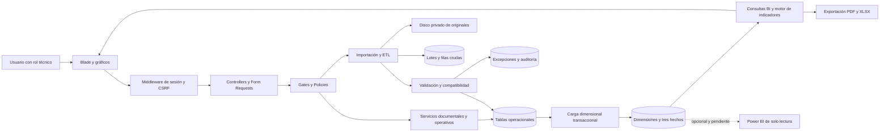
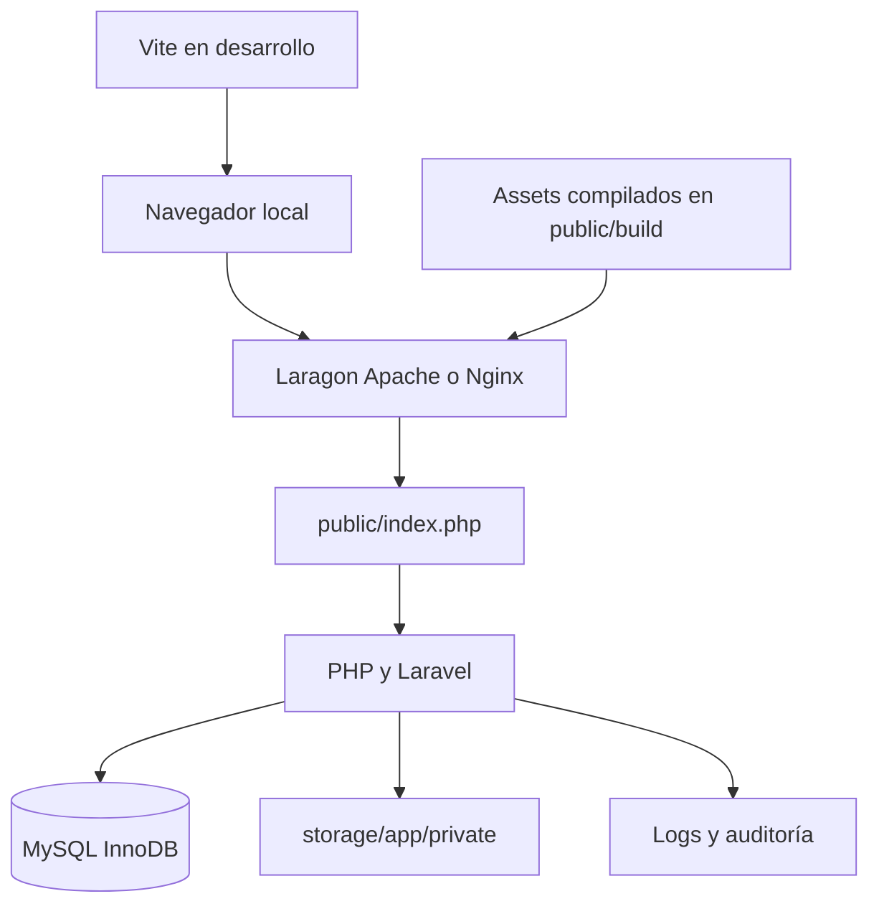
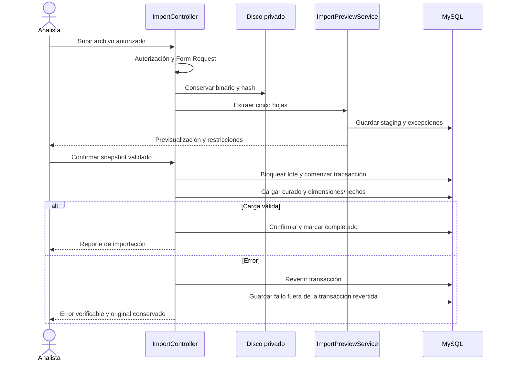

# Arquitectura propuesta

Estado: diseño de Fase 1. Base documental: artículo pp. 4 y 9, figuras 1 y 5. Se propone un monolito modular Laravel con tres niveles y una base MySQL que separa tablas operacionales de tablas analíticas. Resulta suficiente para el corpus inicial y reduce complejidad de despliegue en Laragon.

## Componentes

| Nivel | Indispensable | Responsabilidad |
|---|---|---|
| Presentación | Blade, Tailwind, JavaScript, Chart.js | Formularios, tablas paginadas, vistas ejecutiva/operativa/calidad, trazabilidad, previsualización y reportes |
| Aplicación | Laravel, Fortify, Form Requests, Gates/Policies, servicios, Jobs cuando corresponda | Sesiones, validación, autorización, reglas semánticas, cálculos y coordinación ETL |
| Datos | MySQL InnoDB, disco privado original, filas crudas, tablas curadas, dimensiones y tres hechos | Evidencia, transacciones, linaje y consulta dimensional |

Fortify es la opción oficial propuesta para autenticación con vistas Blade propias. Se deshabilitará registro público; recuperación dependerá de un transporte de correo probado. No se necesita SPA, API pública, Sanctum para sesiones web, microservicios ni un paquete externo de permisos para cuatro roles iniciales.

PhpSpreadsheet leerá y exportará XLSX; se propone usarlo directamente para evitar un adaptador innecesario. Dompdf generará PDF desde vistas de reporte. Los gráficos PDF requerirán imágenes locales generadas y verificadas o una representación tabular equivalente: Dompdf no ejecuta Chart.js. No se aceptará HTML o URL remota arbitraria como plantilla. BCMath preservará cálculo decimal.

Alpine.js es opcional para diálogos y filtros; Jobs con cola de base de datos son opcionales si las importaciones crecen. Redis, contenedores, servicios de geocodificación y aprendizaje automático no son necesarios. Power BI Desktop, conector MySQL y gateway se evaluarán después y permanecerán opcionales; no existe conexión comprobada en esta entrega.

## Flujo y componentes



La zona original conserva el binario sin modificación; staging conserva hoja, celda, fórmula, caché y fila. La zona curada añade interpretación versionada y referencia a la fila cruda. El DW es una proyección reproducible, nunca la única copia de la evidencia. El servicio de compatibilidad se usa en cálculos, filtros y exportaciones.

## Despliegue local previsto



El DocumentRoot debe ser `C:\laragon\www\ResiduosSolidos\public`. No se servirá la raíz del repositorio. MySQL no se expondrá públicamente. Las credenciales se configuran localmente en `.env`, sin publicarlas. Para despliegue externo se verificarán HTTPS, correo, respaldos, permisos, logs y tareas programadas.

## Organización Laravel propuesta

```text
app/Http/Controllers/{Documents,Imports,Operations,BI,Reports,Admin}
app/Http/Requests/
app/Models/
app/Policies/
app/Services/{Documents,Imports,Quality,Indicators,Warehouse,Reports}
app/Jobs/
app/Enums/
database/{migrations,seeders,factories}
resources/views/{auth,layouts,documents,imports,operations,bi,reports,admin}
resources/{css,js}
tests/{Unit,Feature}
docs/01-analisis ... docs/09-evidencias
```

No se creará una carpeta o abstracción sin una responsabilidad concreta. Los Controllers coordinan solicitudes; los servicios concentran transacciones y reglas; las Policies verifican acceso a archivos y entidades; los Models declaran relaciones y casts explícitos. El uso de convenciones de bootstrap, middleware y providers deberá ajustarse al esqueleto de Laravel 13 en Fase 2, sin copiar mecánicamente la estructura de Laravel 10.

## Secuencia de importación propuesta



Los diagramas UML detallados de casos de uso, actividades, componentes internos y pantallas se ampliarán junto al código en las fases indicadas en el plan. Este documento no afirma que los componentes ya estén implementados.
