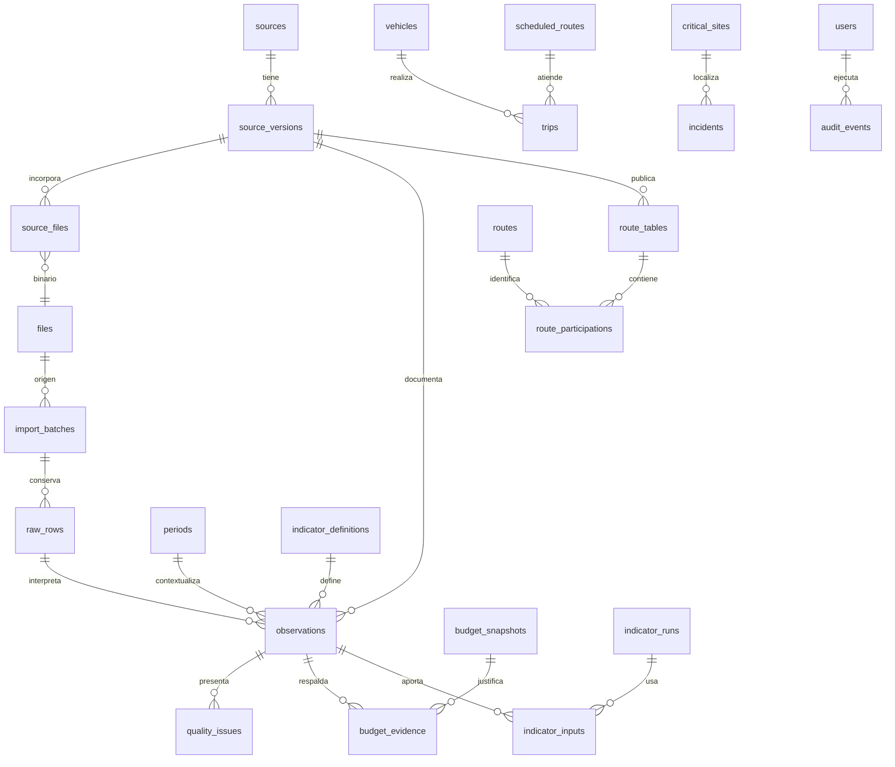
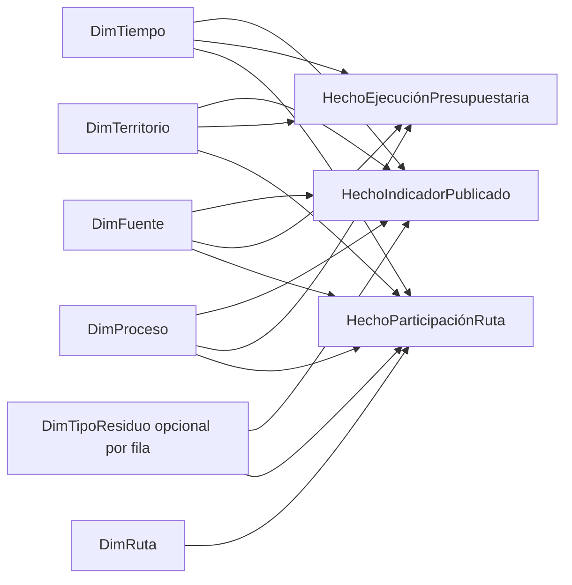

# Modelo inicial de datos

Estado: diseño lógico y físico inicial, pendiente de migraciones y contraste MySQL. Se toma la granularidad del artículo p. 4. Las claves internas serán BIGINT UNSIGNED; los códigos de documentos, registros y rutas se conservarán como claves de negocio con ámbito. Todas las FK serán explícitas y tendrán índice. Motor InnoDB, charset utf8mb4 y collation por definir en Fase 2 según versión; códigos y SHA-256 usarán comparación binaria para evitar equivalencias accidentales.

## Capas y relaciones

`source_files`, `budget_evidence` e `indicator_inputs` son puentes con FK reales. No se utilizará una relación polimórfica sin integridad para el linaje de los hechos. Las entidades operativas futuras no se poblarán desde conteos agregados.

## Diccionario inicial de evidencia y aplicación

Convenciones: PK `id` en cada tabla salvo pivotes; `?` significa NULL permitido con motivo cuando represente ausencia de evidencia; DEC = DECIMAL(24,10), dinero = DECIMAL(20,2), SHA = CHAR(64). Fechas de registro técnico son DATETIME en UTC, mostradas en America/Lima; no son fechas de ocurrencia documental.

| Tabla | Campos principales y tipos | Clave y reglas |
|---|---|---|
| sources | code VARCHAR(32), title TEXT, issuer VARCHAR(255), document_year SMALLINT?, url TEXT?, consulted_on DATE?, access_note TEXT | UNIQUE(code); fecha histórica de consulta no se reemplaza por fecha de importación |
| source_versions | source_id FK, version_no INT, parent_id FK?, description TEXT, issued_on DATE?, status VARCHAR(32), created_by FK | UNIQUE(source_id,version_no); versión sin binario permitida para fuentes catalogadas |
| files | sha256 SHA, private_path VARCHAR(512), original_name VARCHAR(255), mime VARCHAR(128), bytes BIGINT, uploaded_by FK, created_at | UNIQUE(sha256); solo archivos incorporados; no hash declarado como hash calculado |
| source_files | source_version_id FK, file_id FK, role VARCHAR(32) | UNIQUE(source_version_id,file_id,role); admite adjunto de investigación y archivo municipal sin confundirlos |
| declared_fingerprints | source_version_id FK, declared_name VARCHAR(255), algorithm VARCHAR(16), digest SHA, evidence_file_id FK, locator TEXT | Hash declarado de fuente externa, separado del archivo realmente incorporado |
| import_batches | file_id FK, mapping_version VARCHAR(32), status VARCHAR(32), preview_hash SHA?, confirmed_by FK?, confirmed_at?, counts JSON?, failure_code VARCHAR(64)? | UNIQUE(file_id,mapping_version); reintentos como intentos del mismo lote; sin duplicar carga |
| import_attempts | batch_id FK, started_at, finished_at?, status, error_code?, detail TEXT? | Historial de reintentos, sin exponer secretos |
| raw_rows | batch_id FK, sheet_name VARCHAR(64), row_number INT, payload JSON, payload_sha256 SHA | UNIQUE(batch_id,sheet_name,row_number); payload incluye celdas, tipos, formato, fórmula y caché |
| periods | label TEXT, declared_year SMALLINT?, precision VARCHAR(32), start_on DATE?, end_on DATE?, explanation TEXT? | No identidad basada solo en año; ambigüedad y corte parcial explícitos |
| territories | name VARCHAR(255), level VARCHAR(32), official_code VARCHAR(16)?, evidence_version_id FK? | Amarilis distrital documentado; no inventar código UBIGEO ni geometrias |
| processes | code VARCHAR(64), name VARCHAR(255) | UNIQUE(code); generación, recolección, selectiva, segregación, valorización y disposición diferentes |
| waste_types | code VARCHAR(32), name VARCHAR(128) | UNIQUE(code); orgánico/inorgánico solo si identificables |
| units | code VARCHAR(32), description TEXT | UNIQUE(code); conservar t, t/día, t/mes, h/día, km/día, %, S/, rutas y registros |
| indicator_definitions | code VARCHAR(64), label TEXT, unit_id FK, process_id FK, additive_rule VARCHAR(32), universe TEXT | UNIQUE(code); catálogo versionable; no inferir comparabilidad por tener misma unidad |
| observations | source_version_id FK, raw_row_id FK, source_record_code VARCHAR(16), definition_id FK, period_id FK, territory_id FK, waste_type_id FK?, value DEC?, operator VARCHAR(4), qualifier VARCHAR(32)?, locator TEXT, original_period TEXT, note TEXT?, null_reason TEXT?, revision INT, supersedes_id FK?, created_by FK | UNIQUE(source_version_id,source_record_code,revision); R01–R41 conservados; `qualifier` recoge aproximación; naturaleza documental |
| quality_issues | code VARCHAR(32), source_version_id FK, observation_id FK?, batch_id FK?, finding TEXT, restricted_operation VARCHAR(64)?, required_evidence TEXT, status VARCHAR(32), resolved_by FK?, resolution_evidence_id FK? | Q01–Q09 conservadas; puede afectar documento entero; múltiples incidencias por registro |
| routes | source_version_id FK, route_code VARCHAR(32), place_label TEXT, territory_id FK | UNIQUE(source_version_id,route_code); identificador documental, no geometría o ruta operativa global |
| route_tables | source_version_id FK, period_id FK, locator TEXT, table_code VARCHAR(64), process_id FK, waste_type_id FK? | UNIQUE(source_version_id,table_code); identifica cuadro de M24 p. 29 |
| route_participations | route_table_id FK, route_id FK, raw_row_id FK, source_order INT, participants INT, day_label VARCHAR(32)?, schedule_label VARCHAR(64)? | UNIQUE(route_table_id,route_id); participantes >=0; no tabla de personas individuales |
| budget_snapshots | source_version_id FK, activity_code VARCHAR(64), activity_label TEXT, period_id FK, territory_id FK, process_id FK, budget_kind VARCHAR(32), assigned DECIMAL(20,2)?, executed DECIMAL(20,2)?, null_reason TEXT? | UNIQUE(source_version_id,activity_code,period_id,budget_kind); E26 aprobado con ejecutado NULL |
| budget_evidence | budget_snapshot_id FK, observation_id FK, operand_role VARCHAR(32) | UNIQUE(snapshot,operand_role); asignado, ejecutado, porcentaje publicado, componente |
| formula_versions | code VARCHAR(64), version INT, expression TEXT, output_unit_id FK, preconditions JSON, rounding_rule TEXT | UNIQUE(code,version); expresiones autorizadas, nunca eval de texto subido |
| indicator_runs | formula_version_id FK, scope_key SHA, status VARCHAR(32), value DECIMAL(65,30)?, operator VARCHAR(4)?, reason TEXT?, created_at | Resultado calculado reproducible y separado de observación publicada; escala de cálculo 30, sin redondeo adicional al persistir |
| indicator_inputs | indicator_run_id FK, observation_id FK, operand_role VARCHAR(64) | UNIQUE(run,operand_role,observation); FK a revisiones concretas |
| indicator_route_inputs | indicator_run_id FK, route_participation_id FK, operand_role VARCHAR(64) | Puente específico para cálculos de rutas, sin confundir códigos R01 |
| operational_observations | evidence_file_id FK, process_id FK, period_id FK, territory_id FK, waste_type_id FK?, value DEC?, unit_id FK, operator, status, created_by FK, reviewed_by FK?, review_note TEXT? | Naturaleza operativo posterior; borrador/revisado/rechazado; nunca insertado como R42 automático |
| audit_events | actor_id FK?, action VARCHAR(64), entity_type VARCHAR(128), entity_key VARCHAR(128), occurred_at, correlation_id VARCHAR(64), changes JSON?, reason TEXT? | Solo anexar; sin contraseñas/tokens; FK de actor conservada sin borrado físico de usuarios |

## Seguridad y operación futura

| Tablas propuestas | Campos y relaciones principales | Carga inicial |
|---|---|---|
| users, roles, permissions, role_user, permission_role | email único, password hash, estado, roles y permisos por pivotes; tablas de sesión y recuperación oficiales | Sin usuarios municipales ficticios; administrador por comando interactivo futuro |
| vehicles, vehicle_statuses, vehicle_assignments | ID real, placa verificada?, tipo, estado con vigencia, evidencia, asignación a ruta/actividad | Vacías; no crear 13 unidades desde R27 |
| scheduled_routes, trips | ruta operativa con evidencia y fecha; viaje con vehículo, ruta?, origen, destino, fecha, pesaje?, horas?, evidencia y revisión | Vacías; ruta documental no implica programación o recorrido |
| critical_sites, incidents | sitio y ubicación documentada, latitud DECIMAL(10,7)?, longitud DECIMAL(10,7)?, evidencia geográfica?, identificación, intervención?, responsable?, cierre?, estado y evidencia | Vacías; 18 identificados no permiten individualizarlos |
| material_batches, treatment_events | lote, material recibido, proceso, aprovechamiento, rechazo, destino, fecha y evidencia | Vacías; estructura ampliable para trazabilidad futura de valorización |

Las coordenadas deben ser ambas NULL o ambas verificadas, dentro de rango geográfico, y con fuente de ubicación; no usar (0,0) como ausencia. El cierre de incidencia exige intervención, responsable, fecha y evidencia. La fecha de cierre no precede a la de identificación. Los viajes pueden carecer de ruta programada en atención extraordinaria, conservando motivo. No se conectarán estos registros a hechos documentales mediante números supuestos.

## Modelo dimensional

| Tabla analítica | Campos y grano | Integridad y agregación |
|---|---|---|
| dw_dim_time | period_id FK UNIQUE, label, year?, precision, start_on?, end_on? | Una fila por período contextual, no forzar calendario diario |
| dw_dim_territory | territory_id FK UNIQUE, nombre, nivel, código? | Sin bajar a sectores cuando el indicador sea distrital |
| dw_dim_source | source_version_id FK UNIQUE, código, título, emisor, año, URL | Una versión por miembro; originales siguen en aplicación |
| dw_dim_process | process_id FK UNIQUE, código, nombre | Procesos separados |
| dw_dim_route | route_id FK UNIQUE, código y lugar | Solo para rutas identificadas |
| dw_dim_waste_type | waste_type_id FK UNIQUE, código, nombre | FK NULL si no documentado, sin asignar tipo por suposición |
| dw_fact_published_indicator | observation_id FK UNIQUE; dimensiones tiempo, territorio, fuente, proceso, residuo?; definition_id FK, value DEC?, operator, qualifier? | Indicador por documento y corte, con revisión concreta; sin sumar porcentajes, existencias o cortes acumulados |
| dw_fact_budget_execution | budget_snapshot_id FK UNIQUE; dimensiones tiempo, territorio, fuente, proceso; activity_code, budget_kind, assigned?, executed? | Actividad por corte dentro de versión fuente; tasas calculadas por actividad; no sumar períodos ni mezclar plan con ejecución |
| dw_fact_route_participation | route_participation_id FK UNIQUE; dimensiones tiempo, territorio, fuente, proceso, ruta, residuo?; table_code, participants | Ruta por cuadro publicado; suma válida dentro del mismo cuadro; no identifica personas |

Los nombres físicos en inglés son una convención Laravel. Su correspondencia con los tres hechos del artículo está definida arriba. HechoIndicadorPublicado almacena datos publicados, no resultados del motor; `indicator_runs` y vistas analíticas conservan resultados derivados. Los importes presupuestarios también presentes como observaciones no se sumarán de nuevo al consultar el hecho presupuestario. Las vistas BI seleccionarán un hecho por consulta y agregarán antes de combinar dimensiones; nunca unirán presupuesto directamente a once filas de rutas.

El motor mantendrá BCMath a escala 30 y los operandos/versiones permitirán reproducir la expresión original. Los porcentajes se redondearán a dos decimales únicamente para presentación, sin reutilizar el porcentaje mostrado como operando. La reproducción independiente a 40 dígitos de Fase 1 sirve de referencia para probar esa implementación. Si una futura fuente excede la escala de almacenamiento de observaciones, el importador debe rechazar la pérdida de precisión y solicitar una ampliación de esquema, conservando siempre el texto crudo.

## Restricciones e índices

1. `value IS NULL` exige `null_reason`; no asignar DEFAULT 0 a medidas. `operator` admite inicialmente `=` y `>`; la lista se ampliará solo ante evidencia. El formato `Exacto` del Excel se preserva en crudo y se normaliza como `=`.
2. CHECK de importes y conteos no negativos; CHECK de fechas solo cuando ambas estén declaradas; no se obliga a completar fechas ausentes. El ejecutado superior al asignado genera excepción y revisión, sin alterar la evidencia ni rechazarla por una regla contable no demostrada.
3. Índices compuestos sobre observaciones `(source_version_id,period_id,definition_id)`, definición/proceso, territorio, tipo y calidad; hechos sobre sus FK de filtros. Evitar índices redundantes hasta medir consultas.
4. FK con RESTRICT para fuentes, revisiones y evidencia. Usuarios se suspenden, no se borran si tienen autoría. Originales e importaciones confirmadas no tienen borrado ordinario.
5. Una interpretación activa por registro/versionado se resolverá con tabla de punteros `current_observations(source_version_id,source_record_code,observation_id)` y clave única compuesta; la activación validará que la revisión corresponda a su clave. El DW histórico conserva revisiones, y las vistas corrientes seleccionan las activas sin doble conteo.
6. Inicio/fin no se infieren desde «primer semestre» ni desde el nombre del archivo: se guardan etiqueta y precisión semestre. Cualquier futura normalización temporal debe ser explícita, trazable y no sustituir el campo original.

Las migraciones, modelos Eloquent, restricciones exactas, vistas SQL y diccionario final se implementarán y probarán en Fase 3. Este diseño justifica la separación de evidencia inmutable, operaciones revisadas y proyecciones dimensionales; no se entrega como una base ya creada.
